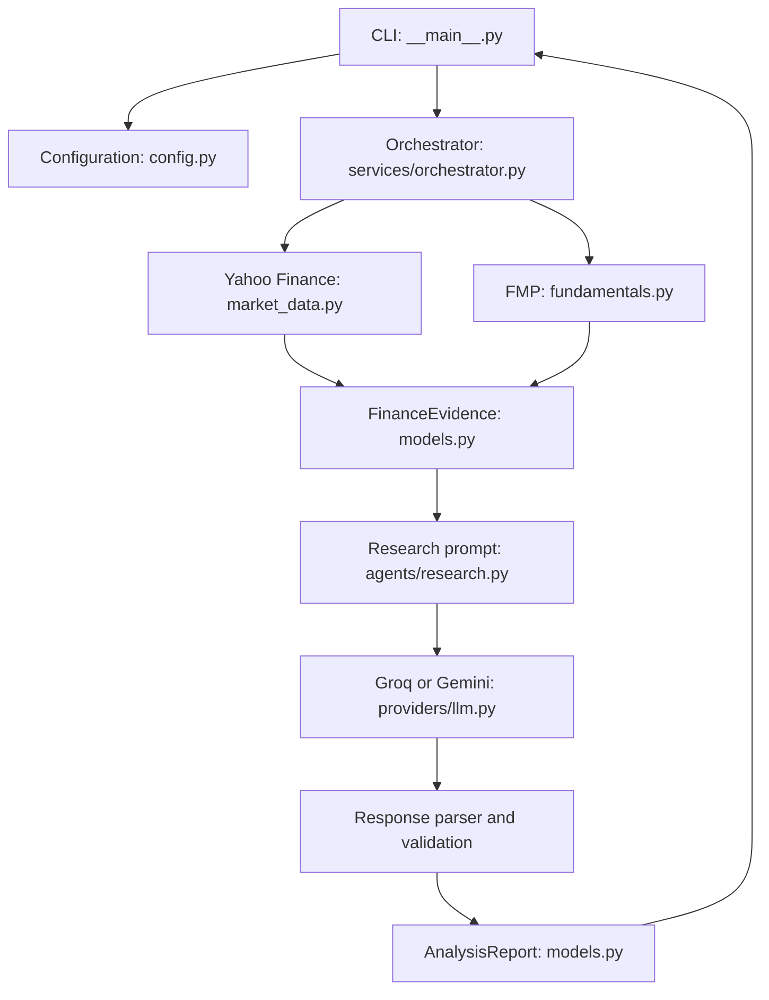

# Finance Agent

Finance Agent is a command-line research assistant for public companies. It collects live market and fundamental data, gives that evidence to an LLM, and returns a structured analysis report.

This project is intended for educational research. It is not investment advice.

## What It Does

The application supports three commands:

```text
finance-agent price AAPL
finance-agent fundamentals AAPL
finance-agent analyze AAPL
```

- `price` retrieves the latest available daily closing price from Yahoo Finance.
- `fundamentals` retrieves company profile information and selected trailing-twelve-month ratios from Financial Modeling Prep (FMP).
- `analyze` combines market data and fundamentals, then asks Groq or Gemini to produce an evidence-grounded research report.

## Requirements

- Python 3.9 or newer
- An FMP API key for `fundamentals` and `analyze`
- A Groq or Gemini API key for `analyze`

## Installation

From the project directory:

```bash
python -m venv .venv
source .venv/bin/activate
python -m pip install --upgrade pip
python -m pip install -e ".[dev]"
```

On Windows PowerShell, activate the environment with:

```powershell
.venv\Scripts\Activate.ps1
```

## Configuration

Create a `.env` file in the project directory. Choose either Groq or Gemini as the LLM provider.

Example using Groq:

```dotenv
LLM_PROVIDER=groq
GROQ_API_KEY=your-groq-api-key
FMP_API_KEY=your-fmp-api-key
GROQ_MODEL=openai/gpt-oss-120b
```

Example using Gemini:

```dotenv
LLM_PROVIDER=gemini
GEMINI_API_KEY=your-gemini-api-key
FMP_API_KEY=your-fmp-api-key
GEMINI_MODEL=gemini-2.5-flash
```

The application does not require every key at startup. Keys are checked only when the corresponding provider or command is used. Do not commit `.env` or API keys to source control.

## Usage

Fetch a price:

```bash
finance-agent price AAPL
```

Fetch fundamentals:

```bash
finance-agent fundamentals AAPL
```

Run an analysis with the configured provider:

```bash
finance-agent analyze AAPL
```

Select a provider for one command:

```bash
finance-agent analyze AAPL --provider gemini
```

Ask a custom research question:

```bash
finance-agent analyze AAPL \
  --question "What are the strongest profitability signals and the main risks?"
```

Print the validated report as JSON:

```bash
finance-agent analyze AAPL --json
```

Run the CLI help:

```bash
finance-agent --help
finance-agent analyze --help
```

## Application Design

The application is organized into layers:



### Runtime flow

For `finance-agent analyze AAPL`:

1. `finance_agent.__main__` parses the command-line arguments.
2. `config.py` loads provider settings and API keys from the environment.
3. `services/orchestrator.py` normalizes the ticker to `AAPL`.
4. `providers/market_data.py` retrieves the latest Yahoo Finance close.
5. `providers/fundamentals.py` retrieves the FMP profile and TTM ratios.
6. `models.py` validates the collected values as a `FinanceEvidence` object.
7. `agents/research.py` builds a prompt that restricts factual claims to the supplied evidence.
8. `providers/llm.py` sends the prompt to Groq or Gemini.
9. The response parser validates the JSON and converts it into an `AnalysisReport`.
10. The CLI prints either a readable summary or the report as JSON.

### Important modules

- `finance_agent/__main__.py`: command-line interface and output formatting.
- `finance_agent/config.py`: environment-backed settings and API-key validation.
- `finance_agent/models.py`: Pydantic data contracts shared between layers.
- `finance_agent/services/orchestrator.py`: coordinates the end-to-end analysis.
- `finance_agent/providers/market_data.py`: Yahoo Finance adapter.
- `finance_agent/providers/fundamentals.py`: Financial Modeling Prep adapter.
- `finance_agent/providers/llm.py`: Groq and Gemini adapters.
- `finance_agent/agents/research.py`: prompt construction, finding normalization, and response validation.

## Evidence and Validation

The model is instructed to use only the collected evidence. After the model responds:

- The response must be valid JSON.
- The report must satisfy the Pydantic `AnalysisReport` contract.
- Sources are replaced with the authoritative sources collected by the application.
- Evidence is replaced with the locally collected `FinanceEvidence` object.

This means the LLM can write the interpretation, but it cannot change the underlying price, fundamentals, or source metadata returned by the providers.

## Development

Run formatting checks, tests, and bytecode compilation:

```bash
.venv/bin/ruff check finance_agent tests
.venv/bin/python -m pytest -q
.venv/bin/python -m compileall -q finance_agent
```

The tests focus on configuration behavior, response validation, finding normalization, and FMP request/error handling. Provider calls are mocked in unit tests, so live API behavior is not tested automatically.

## Current Limitations

- Provider calls are synchronous.
- There is no retry policy, caching, rate limiting, or circuit breaker.
- `analyze` requires both market data and FMP fundamentals; it does not produce partial reports.
- LLM output is requested as JSON, but generation is not schema-constrained by the provider.
- The price is the latest available daily close, not necessarily a real-time quote.
- Unexpected network or SDK errors may escape as tracebacks from the CLI.
- The application makes separate FMP requests for profile and ratios data.

## Project Layout

```text
finance_agent_project/
├── finance_agent/
│   ├── __main__.py
│   ├── config.py
│   ├── models.py
│   ├── agents/
│   │   └── research.py
│   ├── providers/
│   │   ├── fundamentals.py
│   │   ├── llm.py
│   │   └── market_data.py
│   └── services/
│       └── orchestrator.py
├── tests/
│   └── test_finance_agent.py
├── dev-requirements.txt
└── pyproject.toml
```
